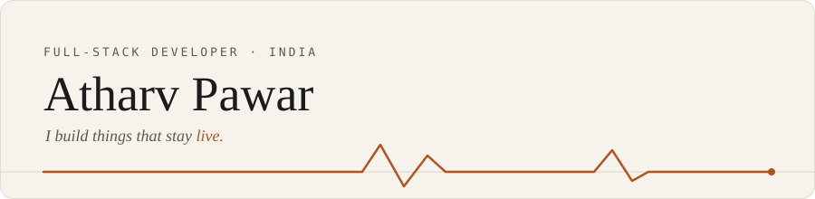

## About

I'm Atharv Dattatraya Pawar, a self-taught full-stack developer from India. I'm studying for a Bachelor of Commerce, and I learn to code by building things. Most of what I make runs on free tiers, which keeps me honest about what an app really needs.

## Selected work

| Project | What it is | Built with |
| --- | --- | --- |
| [GlobalPulse](https://github.com/atharvpawar16/GlobalPulse) | Real-time world-events dashboard. Reads 40+ live news and alert feeds, sorts each event by type, and pins them on a satellite map that refreshes itself. [Live](https://globalpulse-mdmw.onrender.com) | C#, ASP.NET Core, SignalR, PostgreSQL, Leaflet |
| [ADP Chathouse](https://github.com/atharvpawar16/adpchathouse-app) | Android group chat with a terminal look. Anonymous rooms, real-time messaging, no phone number needed. [Web version](https://atharvpawar16.github.io/adpchathouse-app/) | Java, Android, Firebase |
| [APDocs Studio](https://github.com/atharvpawar16/APDocsStudio) | Windows app for scanning, editing and exporting photos and PDFs, with OCR. Built on the open-source NAPS2 (GPL-2.0), with credit to its authors. [Site](https://apdocsstudio.netlify.app/) | C#, .NET |
| [Fog Mirror](https://github.com/atharvpawar16/fog-mirror) | A fogged-up mirror in the browser that you wipe clear with a mouse, a finger, or your hand in front of the webcam. One HTML file. [Try it](https://fog-mirror-atharv.netlify.app) | JavaScript, Canvas, Hand tracking, Web Audio |
| Atharv's Private Vault | Private cloud storage for my own photos and videos. Two-factor admin login, view-only guest access, expiring share links and fast previews. Private repository, no public link. | TypeScript, Next.js, Express |
| EDITH | Windows tool that uses all of a PC's network connections at the same time, so downloads and online tasks run faster. Made for personal use; based on the open-source Plexo project (MIT). Private repository, no public link. | TypeScript, Windows, Networking |
| MERLIN | Multi-cloud storage web app from a university project team I worked with. Joins several cloud storage accounts into one view, with file placement, duplicate removal, sync and recovery. Private repository, no public link. | TypeScript, React, Express, Prisma |

## Stack

**Languages** - C# · JavaScript · TypeScript · Java · HTML & CSS

**Frameworks** - ASP.NET Core · SignalR · Next.js · React · Node.js · Express

**Data & hosting** - PostgreSQL · Firebase · Netlify · Vercel · Render

## Stats

## Metrics

## Practice & coding time

## Badges

Dapr Community Supporter - awarded by the [Dapr](https://dapr.io/) project for supporting its community.

My [daily.dev](https://daily.dev/atharvpawar16) DevCard - the topics I read and follow on daily.dev.

## Find me

[Portfolio](https://atharvpawar16.netlify.app/) · [GitHub](https://github.com/atharvpawar16) · [Instagram](https://instagram.com/atha_rvpawar16) · [adp060606@gmail.com](mailto:adp060606@gmail.com)

